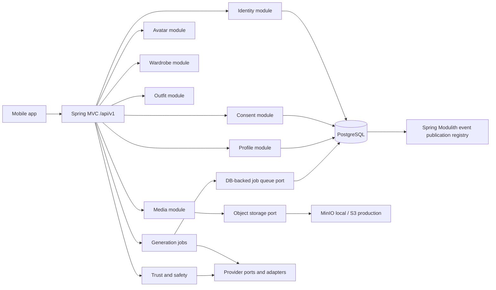
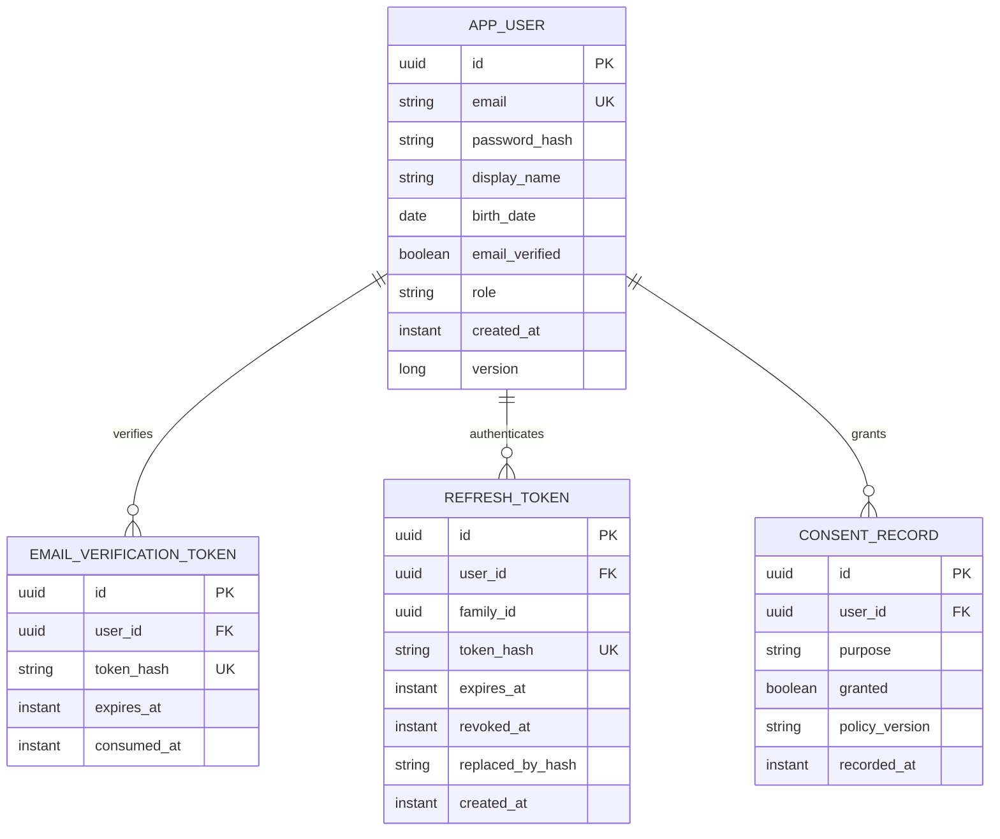

# AuraFit architecture

## Context and runtime

AuraFit is a versioned REST API for a mobile virtual-wardrobe and try-on product. It is a single deployable Spring Boot modular monolith, not a set of microservices. Business capabilities are package-by-feature modules. Within each module, web and infrastructure adapters depend on application use cases and ports; the domain remains independent of Spring, persistence, HTTP, and AI vendors.

The diagram includes the planned whole-product boundaries. Phase 1 implements identity, consent, shared API/security infrastructure, and the database/deployment foundation only. Later capabilities must not be exposed as empty placeholder endpoints.

## Module map

| Module | Responsibility | Phase |
|---|---|---|
| `identity` | Adult registration, password hashing, email verification, sign-in, access and rotating refresh tokens, account ownership | 1 |
| `consent` | Append-only, purpose-specific consent decisions and policy versions | 1 |
| `profile` | User profile and optional measurements | 2 |
| `media` | Validated uploads, metadata stripping, storage and presigned URL policies | 2 |
| `avatar` | Avatar creation request and lifecycle | 2 |
| `generation` | Idempotent asynchronous jobs, retries, quotas and DB-backed worker | 2 |
| `wardrobe` | Owned and wishlist garment lifecycle and filters | 3 |
| `outfit` | Outfit assembly, tags and favorites | 4 |
| `trustsafety` | Moderation, identity checks, reports/takedowns and generated-image provenance | 2 onward |
| `shared` | API errors, configuration, security infrastructure; no feature-specific business logic | 1 |

Modules expose use cases or explicitly published events, not persistence entities or internal packages. `identity` and `consent` own their tables. A future module must publish a narrow public API or event rather than import another module's infrastructure package.

## Phase 1 data model

Passwords are encoded with Spring Security's delegating encoder. Verification and refresh credentials are 256-bit random opaque values; only their SHA-256 digests are persisted. Refresh tokens rotate within a family; reuse revokes all active tokens in that family. Access JWTs are short-lived and signed with an environment-supplied HMAC key through Spring Security/Nimbus.

Consent decisions are immutable records; the latest decision for a purpose is authoritative. Upload, avatar, and provider processing use cases must require their applicable latest granted consent before processing. Face photos and derived avatar assets are sensitive data; future media flows must apply minimization, restricted retention, encryption, and cascading deletion.

## Cross-cutting behavior

- HTTP contracts are under `/api/v1`; errors use RFC 9457 Problem Details with a stable `code`.
- `spring.jpa.hibernate.ddl-auto=validate`; Flyway is the only schema evolution mechanism.
- Authentication is stateless. CORS is an explicit origin allow-list, CSRF is disabled for bearer-token APIs, and security headers are enabled.
- Authentication endpoints have IP-based token-bucket rate limiting and per-email/IP temporary lockout. These in-memory controls are single-instance MVP safeguards; production horizontal scaling requires shared/distributed state or an upstream gateway.
- Local services are PostgreSQL, private MinIO, and Mailpit. Production storage remains behind a port and uses AWS S3-compatible configuration.
- Actuator health probes, Micrometer metrics, structured logging, and correlation-aware tracing are required; production secrets and PII must never be logged.
- Spring Modulith's JPA event publication registry is the selected mechanism for reliable cross-module events. The Phase 1 scaffold includes the registry dependency; event consumers should be introduced with the first cross-module workflow and must not persist bearer credentials in event payloads.

## Quality and delivery

`./mvnw verify` runs tests, formatting, Checkstyle, and the JaCoCo coverage gate (80% line coverage for domain/application packages). Tests are layered: pure use-case/domain tests, web/security tests, PostgreSQL/MinIO integration tests, and module-boundary verification. GitHub Actions runs build/test/coverage, CodeQL, dependency scanning, and a container build/scan; image publishing is restricted to `main`.

## Phase 1 request flow

1. Registration validates input and the 18+ age gate, stores a BCrypt-encoded password, and persists only a hash of the single-use email token.
2. The email adapter sends a verification link through SMTP (Mailpit locally). Login remains unavailable until verification succeeds.
3. Login issues an issuer-validated 15-minute JWT and a 30-day opaque refresh token. Refresh atomically consumes the previous token and issues a new one; detected reuse revokes the family.
4. `/auth/me` and consent endpoints derive the owner UUID from the validated JWT subject; no client-supplied user ID is trusted.
5. Consent updates append a purpose, grant/revoke value, policy version, and timestamp. Account deletion and all-derived-data cleanup are deferred to the hardening phase.
